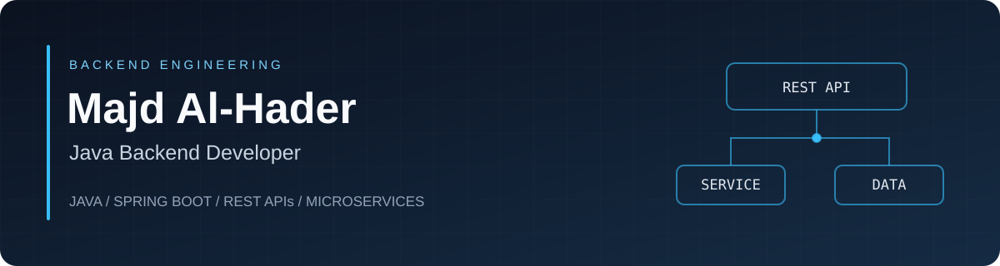

  

  <a href="https://www.linkedin.com/in/majd-al-hader-056113228/"><strong>Connect on LinkedIn ↗</strong></a>
  &nbsp; · &nbsp;
  <a href="#selected-projects"><strong>Explore my projects ↓</strong></a>

---

### About me

I'm a **Java Developer at Inspire for Solutions Development**, based in Jordan. I work on backend services, external API integrations, relational databases, and JasperReports.

**B.Sc. in Computer Information Systems — University of Jordan**

### Selected projects

<table>
<tr>
<td width="50%" valign="top">

#### [JU Activity Approval System](https://github.com/AlhaderMajd/Graduation-Project)
University activity management backend.

**Spring Boot · MySQL · JWT**

[Explore code & setup →](https://github.com/AlhaderMajd/Graduation-Project#readme)

</td>
<td width="50%" valign="top">

#### [Book Social Network](https://github.com/AlhaderMajd/book-social-network)
Book sharing, borrowing, and authentication.

**Spring Boot · PostgreSQL**

[Explore code & setup →](https://github.com/AlhaderMajd/book-social-network#readme)

</td>
</tr>
<tr>
<td width="50%" valign="top">

#### [Database Fragmentation Analysis](https://github.com/AlhaderMajd/Database-Vertical-Fragmentation-Analysis)
Interactive database analysis.

**Database design · Attribute affinity**

[Explore the project →](https://github.com/AlhaderMajd/Database-Vertical-Fragmentation-Analysis#readme)

</td>
<td width="50%" valign="top">

#### [Library Management System](https://github.com/AlhaderMajd/SpringBootLibraryManagementSystem)
Books, users, and role-based access.

**Java · Spring Boot · MySQL**

[Explore the project →](https://github.com/AlhaderMajd/SpringBootLibraryManagementSystem)

</td>
</tr>
</table>

### Technical toolkit

| Backend | Data & persistence | Development & integration |
| :--- | :--- | :--- |
| **Java** · Spring Boot | **PostgreSQL** · MySQL | Git · Docker · OpenShift |
| Spring Security · REST APIs | SQL · JPA / Hibernate | Postman · IBM API Connect |
| Microservices | JasperReports | IntelliJ IDEA · DataGrip |

### Current focus

**Spring Security** &nbsp; / &nbsp; **Distributed systems** &nbsp; / &nbsp; **Testing** &nbsp; / &nbsp; **Service integration**

---

  <strong>Java backend engineering · APIs · Relational databases</strong> 
  <a href="https://www.linkedin.com/in/majd-al-hader-056113228/">Let's connect on LinkedIn</a>

