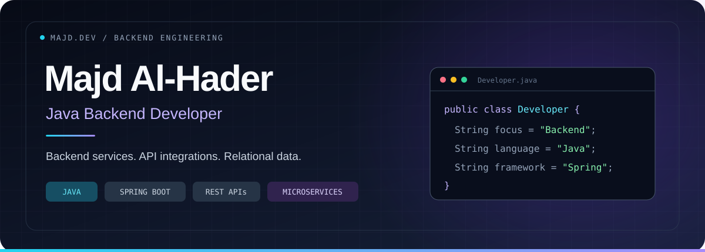
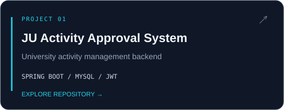
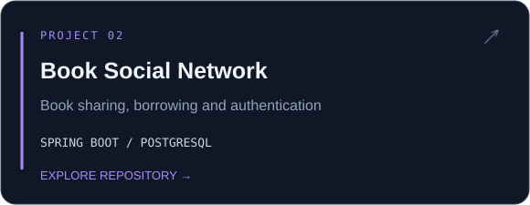
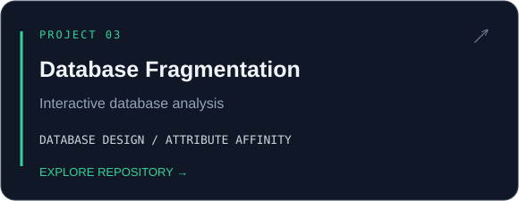
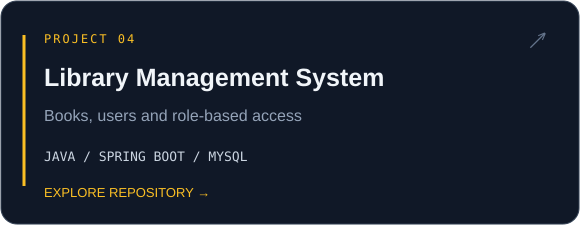

<strong><a href="https://www.linkedin.com/in/majd-al-hader-056113228/">LINKEDIN ↗</a> &nbsp; · &nbsp; <a href="#selected-work">SELECTED WORK ↓</a> &nbsp; · &nbsp; <a href="#technical-toolkit">TECHNICAL TOOLKIT ↓</a></strong>

---

### About me

I'm a **Java Developer at Inspire for Solutions Development**, based in Jordan. I work on backend services, external API integrations, relational databases, and JasperReports.

**B.Sc. in Computer Information Systems — University of Jordan**

### Selected work

### Technical toolkit

| Backend engineering | Data & persistence | Development & integration |
| :--- | :--- | :--- |
| **Java** · **Spring Boot** | **PostgreSQL** · **MySQL** | **Git** · **Docker** |
| Spring Security · REST APIs | SQL · JPA / Hibernate | OpenShift · IBM API Connect |
| Microservices | JasperReports | Postman · IntelliJ IDEA · DataGrip |

### Learning focus

> **Spring Security** · **Distributed systems** · **Testing** · **Service integration**

---

<strong>Java backend engineering · APIs · Relational databases</strong>  
<a href="https://www.linkedin.com/in/majd-al-hader-056113228/"><strong>LET'S CONNECT ↗</strong></a>

